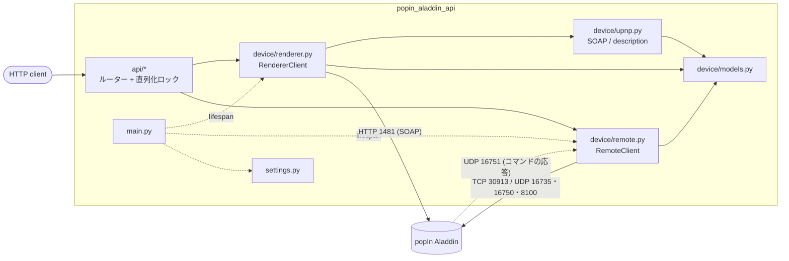
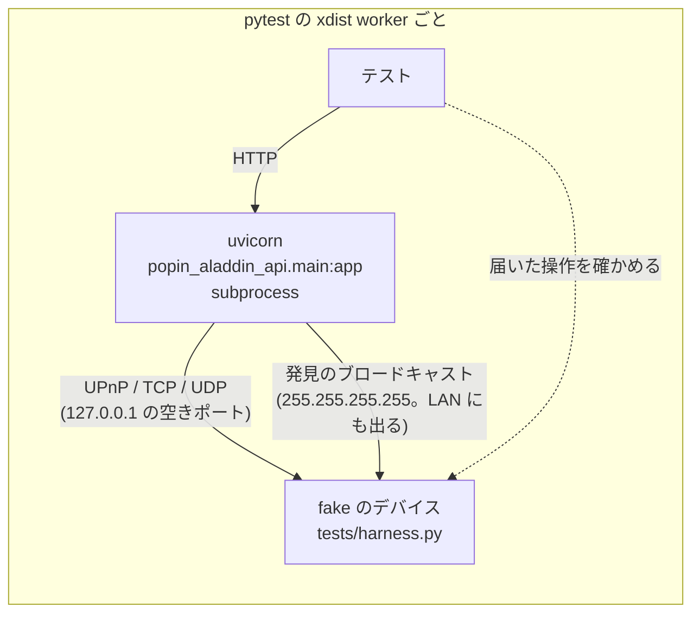

# 開発

セットアップと起動は [README](../README.md)、`mise run` のタスクは README の「タスク」にあります。

## 構成

```
src/popin_aladdin_api/
  settings.py        環境変数の設定 (pydantic-settings)
  main.py            FastAPI アプリ、lifespan、device 層の例外 → HTTP status
  api/               FastAPI ルーター
    renderer.py      再生・音量・キャスト・SOAP パススルー
    remote.py        ライト・キー・文字入力・音声・deeplink・デバイス情報・スクリーンショット・電源・発見
    system.py        /health
    schemas.py       リクエストモデル
    deps.py          依存性注入と直列化ロック
  device/            デバイス制御層 (FastAPI に依存しない async のクライアント)
    renderer.py      UPnP/DLNA MediaRenderer クライアント (httpx)
    remote.py        独自プロトコルのクライアント (asyncio の TCP / UDP、発見のブロードキャスト)
    upnp.py          SOAP / device description / DIDL-Lite の純粋関数
    models.py        列挙型 (PlayMode / LightButton / ProjectorKey) と応答モデル
    errors.py        AladdinError / AladdinConnectionError / AladdinSoapError
tests/               機能ごとの e2e テストと、fake のデバイス・API サーバーの起動 (harness.py)
```



各ポートの形式は [プロトコルの詳細](protocol.md) にあります。

### 層の依存

`pyproject.toml` の `[tool.importlinter]` が、次の向きの依存だけを許します (`mise run lint` で検査)。

| 範囲                | 上の層 → 下の層                                          |
| ------------------- | -------------------------------------------------------- |
| `popin_aladdin_api` | `main` → `api` → `settings` → `device`                   |
| `api`               | `remote` \| `renderer` \| `system` → `deps` \| `schemas` |
| `device`            | `remote` \| `renderer` → `upnp` → `errors` \| `models`   |

- 上の層は途中の層を飛ばして import でき、`|` で並べた同じ層のモジュールどうしは import できません。
- `popin_aladdin_api`・`api`・`device` の直下にモジュールを足したら、契約の `layers` にも足します (`exhaustive = true` なので、足さないと失敗します)。
- 外部パッケージを直接 import できるのは、fastapi が `main`・`api`、httpx が `device.renderer`、pydantic_settings が `settings` だけです。

### 直列化

デバイスに触るリクエストは、プロセス内の 1 つの `asyncio.Lock` で 1 つずつ実行します。
複数の SOAP 呼び出しから成る操作 (cast・status) に別のリクエストが割り込まず、方向キーの押下 → 離上の列も崩れません。
ロックはプロセスの中でだけ効くので、uvicorn は 1 プロセス (`--workers 1`) で動かします。

## テスト

テストは、利用者と同じく HTTP で API を呼ぶ e2e テストです。実機には接続しません。



- API サーバーは本番と同じコマンドで起動し、fake の接続先だけを環境変数で渡します。
- fake は [プロトコルの詳細](protocol.md) の各ポートを受け付け、届いた操作を記録します。
- どんな入力でも成り立つべき契約 (文字列がそのままデバイスに届く、範囲外の値を拒否する等) は、Hypothesis で入力を生成して確かめます。
- coverage は API サーバーの subprocess も計測します。その計測が欠けると `mise run test` は失敗します。

## Docker イメージ

| 項目         | 内容                                                                                                                                        |
| ------------ | ------------------------------------------------------------------------------------------------------------------------------------------- |
| ランナー     | `gcr.io/distroless/cc-debian13:nonroot` (shell とパッケージマネージャが無い)                                                                |
| Python       | distroless に Python 3.14 のイメージが無いので、ビルダで uv が配布する Python を入れ、使わないファイル (tcl/tk・pip・ヘッダ等) を除いて写す |
| 中身         | その Python と、依存とこのパッケージを入れた `.venv` だけ                                                                                   |
| 実行ユーザー | UID 65532 (非 root)                                                                                                                         |

root filesystem を read-only にし、capability をすべて外しても動きます。`mise run run-image` はその設定で起動します。

| `docker run`                       | docker compose                           |
| ---------------------------------- | ---------------------------------------- |
| `--read-only`                      | `read_only: true`                        |
| `--cap-drop ALL`                   | `cap_drop: [ALL]`                        |
| `--security-opt no-new-privileges` | `security_opt: [no-new-privileges:true]` |

shell が無いので、`docker exec <container> sh` で入れず、shell を前提にしたコマンド (compose の healthcheck の `CMD-SHELL`、`command` の中のパイプや変数展開等) も動きません。
中を調べるときは `docker run --rm --entrypoint python popin-aladdin-api:latest -c '<code>'` で起動します。

## ツールと依存

| 対象                                                                                          | 固定する場所                                                                                  | 変えたとき                                                                                                         |
| --------------------------------------------------------------------------------------------- | --------------------------------------------------------------------------------------------- | ------------------------------------------------------------------------------------------------------------------ |
| ツール (uv / prek / dprint / jactionlint / shellcheck / hadolint / typos / zizmor / gitleaks) | `mise.toml` の `[tools]` (exact version)、`mise.lock` (プラットフォームごとの URL / checksum) | `mise lock` で `mise.lock` を追従させ、同じ commit に含める (古いと CI の `mise install --locked` が失敗する)      |
| Python 本体                                                                                   | `.python-version` (3.14 の minor)                                                             | uv が手元・CI・Docker の build で同じ minor を取得する。上げる前に依存とツールの対応を確かめる (Renovate の対象外) |
| Python の依存                                                                                 | `pyproject.toml`、`uv.lock`                                                                   | `mise exec -- uv lock` で `uv.lock` を更新し、同じ commit に含める                                                 |

CI もローカルも同じ `mise.lock` からツールを解決するので、CI の検査をローカルで再現できます。

Python の依存は、`pyproject.toml` の `[[tool.uv.index]]` で既定にした `https://pypi.flatt.tech/simple/` から取得します。
`UV_INDEX_URL` やユーザー設定の `index-url` はこの宣言に負けますが、次を設定して `uv lock` を実行すると `uv.lock` の取得元が変わりえます。

- `UV_DEFAULT_INDEX` (この宣言より優先される)
- `UV_INDEX` やユーザー設定の、`explicit` でない追加の index (既定の index より先に参照される)

`.gitignore` はホワイトリスト方式 (`*` ですべて無視し、`!` の行で許可したものだけを追跡する) です。新しいファイルを追跡するときは `!` の行を足します。

## pre-commit hooks

`mise install` が `prek install` を実行し、`pre-commit`・`pre-push`・`commit-msg` の git hook を登録します。
`.pre-commit-config.yaml` を変えたら `mise exec -- prek install` で登録し直します。
commit が `.git/hooks/pre-commit.legacy` から失敗するときは、以前に別の仕組みで登録した hook が残っています。中身を確かめてから `mise exec -- prek install --force` で置き換えます。

| hook                                                        | commit 時  | push 時 | 対象                                       | 内容                                                     |
| ----------------------------------------------------------- | :--------: | :-----: | ------------------------------------------ | -------------------------------------------------------- |
| trailing-whitespace / end-of-file-fixer / mixed-line-ending |    修正    |    -    | 全ファイル                                 | 空白と改行を直す                                         |
| check-yaml / check-json / check-toml                        |     ✓      |    ✓    | YAML / JSON / TOML                         | 構文を検査する                                           |
| check-added-large-files                                     |     ✓      |    ✓    | 追加するファイル                           | 大きなファイルの追加を止める                             |
| check-merge-conflict                                        |     ✓      |    ✓    | merge・rebase 中のファイル                 | conflict の印を検査する                                  |
| no-commit-to-branch                                         |     ✓      |    -    | -                                          | main を checkout しているときの commit を止める          |
| mise-task-docs                                              |    修正    |    -    | `mise.toml`・`README.md`                   | README のタスク一覧を同期する (`mise run docs`)          |
| dprint-fmt                                                  |    修正    |    -    | json / yaml / markdown / toml / Dockerfile | 整形する                                                 |
| ruff-isort / ruff-format                                    |    修正    |    -    | Python のファイル                          | commit するファイルの import を並べ替えて整形する        |
| lint                                                        |     ✓      |    -    | Python のファイル・Python の設定 (\*)      | 作業ツリー全体に `mise run lint` を実行する              |
| test                                                        |     -      |    ✓    | Python のファイル・Python の設定 (\*)      | `mise run test` を実行する                               |
| jactionlint                                                 |     ✓      |    ✓    | workflow                                   | workflow の静的検査                                      |
| zizmor                                                      |     ✓      |    ✓    | `.github/`・`.pre-commit-config.yaml`      | workflow と hook の設定のセキュリティ監査                |
| hadolint                                                    |     ✓      |    ✓    | Dockerfile                                 | Dockerfile の静的検査                                    |
| typos                                                       |     ✓      |    ✓    | 全ファイル                                 | 英単語の typo を検査する                                 |
| gitleaks                                                    |     ✓      |    -    | staged の差分                              | secret を検出する                                        |
| commitlint                                                  | commit-msg |    -    | commit message                             | Conventional Commits (`type(scope): subject`) か検査する |

(\*) `.py`・`.pyi`・`pyproject.toml`・`uv.lock`・`.python-version`・`mise.toml`・`mise.lock` の変更か削除。

- ファイルを書き換える hook (表の「修正」) は commit 時だけに走ります。push 時の hook は push する commit ではなく作業ツリーを見るので、次の作業のファイルを書き換えないためです。
- `lint` と `test` は手元の事前検査で、push した変更の最終的な判定は PR の CI が行います。
- `mise run pre-commit` は検証用なので、main を checkout したままでも使えるよう `no-commit-to-branch` を除きます。

### 各ツールの設定

| ツール                                                                  | 設定                             | 要点                                                                                                                                                                                                                                                |
| ----------------------------------------------------------------------- | -------------------------------- | --------------------------------------------------------------------------------------------------------------------------------------------------------------------------------------------------------------------------------------------------- |
| [ruff](https://docs.astral.sh/ruff/) / [ty](https://docs.astral.sh/ty/) | `pyproject.toml`                 | strict。2 引数目以降は keyword-only、相対 import と `from __future__ import annotations` の禁止、上書きするメソッドへの `@override` の強制。`uv.lock` の版を `uv run --locked` で使うので、`uv.lock` が `pyproject.toml` に追従していないと失敗する |
| [import-linter](https://import-linter.readthedocs.io/)                  | `pyproject.toml`                 | 「層の依存」を検査する                                                                                                                                                                                                                              |
| [dprint](https://dprint.dev/)                                           | `dprint.json`                    | plugin の WASM は `url@sha256` で checksum ごと pin する。`uv.lock`・`mise.lock` は対象外                                                                                                                                                           |
| [jactionlint](https://jactionlint.jdx.dev/) (actionlint の fork)        | `.pre-commit-config.yaml` の引数 | actionlint と同じ範囲の `correctness` profile。`warn` も失敗にし、`run:` を [shellcheck](https://github.com/koalaman/shellcheck) で検査する                                                                                                         |
| [hadolint](https://github.com/hadolint/hadolint)                        | `.hadolint.yaml`                 | style を含む全 severity を失敗にする。ベースイメージの registry を docker.io / ghcr.io / gcr.io に限り、OCI label (`org.opencontainers.image.source` / `licenses`) を必須にする                                                                     |
| [typos](https://github.com/crate-ci/typos)                              | `typos.toml`                     | 綴りを米国英語に揃える                                                                                                                                                                                                                              |
| [zizmor](https://docs.zizmor.sh/)                                       | `.pre-commit-config.yaml` の引数 | `--persona auditor` で false positive を含む全 finding を、`--strict-collection` で解析できない入力を失敗にする                                                                                                                                     |
| [gitleaks](https://github.com/gitleaks/gitleaks)                        | -                                | hook は staged の差分、CI の `gitleaks` job はコミット履歴全体を検査する                                                                                                                                                                            |
| [commitlint](https://commitlint.js.org/)                                | `commitlint.config.mjs`          | prek が node と依存を隔離した環境に用意する                                                                                                                                                                                                         |

lint の指摘を抑制するときの書き方です。設定を緩めず、誤検知と外部の仕様のために直せない箇所だけを、理由のコメントを添えて除外します。

| ツール   | 書き方                                                                | 無効な書き方                                  |
| -------- | --------------------------------------------------------------------- | --------------------------------------------- |
| ruff     | 該当行の `# noqa: <code>`                                             | -                                             |
| ty       | 該当行の `# ty: ignore[<rule>]`                                       | `# type: ignore`、規則名の無い `# ty: ignore` |
| hadolint | `.hadolint.yaml` の `ignored`。label は `label-schema` に足す         | Dockerfile の中の `# hadolint ignore=`        |
| typos    | `typos.toml` の `extend-identifiers` (識別子) / `extend-words` (単語) | -                                             |
| zizmor   | 該当行の `# zizmor: ignore[<audit 名>]`                               | -                                             |

zizmor の online audit (impostor-commit 等) は GitHub の token があるときだけ走ります。ローカルで CI と同じ範囲を監査するには次を実行します。

```sh
ZIZMOR_GITHUB_TOKEN=$(gh auth token) mise exec -- zizmor --persona auditor --strict-collection .
```

## CI

`.github/workflows/ci.yaml` は、pull request で次の job を並列に実行します。main への push では実行しません (main は PR 必須で、PR の CI を通ったものだけが入ります)。
job の `name` がそのまま required status check の名前になります。

| job                               | 内容                                                                                                                                                                                                                                                                      |
| --------------------------------- | ------------------------------------------------------------------------------------------------------------------------------------------------------------------------------------------------------------------------------------------------------------------------- |
| `prek`                            | 全追跡ファイルに pre-commit stage の hook を実行する (`no-commit-to-branch` を除く)。`mise.lock` の不整合は mise の導入で、`uv.lock` の不整合は `lint` hook で失敗する。zizmor は online audit 込みで token を渡す別の step で実行し、gitleaks は `gitleaks` job に任せる |
| `gitleaks`                        | コミット履歴全体の secret を検出する                                                                                                                                                                                                                                      |
| `verify`                          | `mise run test`                                                                                                                                                                                                                                                           |
| `image (amd64)` / `image (arm64)` | 各 arch の runner で `mise run check-image`                                                                                                                                                                                                                               |

workflow の `uses:` は commit SHA で固定し、バージョンをコメントで併記します。

## 依存関係の更新 (Renovate)

`renovate.json` の設定で [Renovate](https://docs.renovatebot.com/) が更新の PR を作ります (Renovate GitHub App をこのリポジトリで有効にしておく)。
PR は毎週月曜 9 時前 (Asia/Tokyo) の時間帯に作られます (脆弱性の alert による更新は、曜日と 7 日の猶予を待たずに作られます)。

| 対象                                                                                                                                                                                                        | PR                          | merge                                                                                                            |
| ----------------------------------------------------------------------------------------------------------------------------------------------------------------------------------------------------------- | --------------------------- | ---------------------------------------------------------------------------------------------------------------- |
| `pyproject.toml` の依存と `uv.lock`、`mise.toml` のツールと `mise.lock`、`.pre-commit-config.yaml` の hook の `rev` と `additional_dependencies`、workflow の `uses:`、`dprint.json` の plugin (major 以外) | 1 つにまとめる              | 公開から 7 日経過後、CI が通れば Renovate が自動で merge する。pin・digest の更新が入った PR は人手で merge する |
| `uv.lock` の再解決 (`lockFileMaintenance`、週次)                                                                                                                                                            | 単独                        | CI が通れば自動で merge する                                                                                     |
| `Dockerfile` のベースイメージ (major 以外。uv の tag と digest、distroless の `nonroot` の digest)                                                                                                          | ほかとは別の 1 つにまとめる | 人手で merge する                                                                                                |
| major の更新                                                                                                                                                                                                | 個別                        | 人手でレビューして merge する                                                                                    |

- ベースイメージは GHCR・GCR にあり、Renovate が公開日時を取得できないので、7 日の猶予を置けません。公開日時が無くても PR を作り (`minimumReleaseAgeBehaviour: timestamp-optional`)、自動では merge しません。
- イメージの Python の patch version (と同梱の OpenSSL 等) は uv の版で決まり、uv の更新で変わることがあります。
- `uv.lock` の再解決には公開日時が無いので、7 日の猶予は `pyproject.toml` の `exclude-newer` で守ります。

次は Renovate の対象外で、手で上げます。

- Python の minor version (`.python-version`): 依存とツールが新しい minor に対応したのを確かめてから上げる (`renovate.json` で pyenv manager を無効にしている)。
- distroless の Debian の世代 (`Dockerfile` の `cc-debian13`)。

## GitHub リポジトリ設定

ファイルで管理できないリポジトリの設定です (ruleset と secret scanning は public リポジトリなので使えます)。required checks は「CI」の job の `name` に合わせます。

| 設定            | 内容                                                                                           |
| --------------- | ---------------------------------------------------------------------------------------------- |
| merge           | squash のみ (タイトルは `COMMIT_OR_PR_TITLE`)。merge 後にブランチを自動で削除する。wiki は無効 |
| ruleset (main)  | PR 必須・CI 必須・squash merge のみ・force push と削除の禁止・linear history                   |
| secret scanning | push protection と non-provider patterns を有効にする                                          |
| Actions         | GitHub 公式・verified creator と `jdx/mise-action` だけを許可し、SHA pin を必須にする          |
| Dependabot      | 脆弱性の alert だけを有効にする (更新の PR は Renovate が作るので security updates は使わない) |

次のコマンドで設定します。

```sh
REPO=msageha/popin-aladdin-api

# merge
gh api -X PATCH "repos/$REPO" --input - <<'JSON'
{
  "allow_merge_commit": false,
  "allow_rebase_merge": false,
  "allow_squash_merge": true,
  "squash_merge_commit_title": "COMMIT_OR_PR_TITLE",
  "squash_merge_commit_message": "COMMIT_MESSAGES",
  "delete_branch_on_merge": true,
  "has_wiki": false
}
JSON

# ruleset (main)
gh api -X POST "repos/$REPO/rulesets" --input - <<'JSON'
{
  "name": "Protect main",
  "target": "branch",
  "enforcement": "active",
  "bypass_actors": [],
  "conditions": {"ref_name": {"include": ["refs/heads/main"], "exclude": []}},
  "rules": [
    {"type": "deletion"},
    {"type": "non_fast_forward"},
    {"type": "required_linear_history"},
    {"type": "pull_request", "parameters": {
      "required_approving_review_count": 0,
      "dismiss_stale_reviews_on_push": false,
      "require_code_owner_review": false,
      "require_last_push_approval": false,
      "required_review_thread_resolution": false,
      "allowed_merge_methods": ["squash"]
    }},
    {"type": "required_status_checks", "parameters": {
      "do_not_enforce_on_create": false,
      "strict_required_status_checks_policy": false,
      "required_status_checks": [
        {"context": "prek", "integration_id": 15368},
        {"context": "gitleaks", "integration_id": 15368},
        {"context": "verify", "integration_id": 15368},
        {"context": "image (amd64)", "integration_id": 15368},
        {"context": "image (arm64)", "integration_id": 15368}
      ]
    }}
  ]
}
JSON

# secret scanning
gh api -X PATCH "repos/$REPO" --input - <<'JSON'
{
  "security_and_analysis": {
    "secret_scanning": {"status": "enabled"},
    "secret_scanning_push_protection": {"status": "enabled"},
    "secret_scanning_non_provider_patterns": {"status": "enabled"}
  }
}
JSON

# Actions
gh api -X PUT "repos/$REPO/actions/permissions" --input - <<'JSON'
{"enabled": true, "allowed_actions": "selected", "sha_pinning_required": true}
JSON
gh api -X PUT "repos/$REPO/actions/permissions/selected-actions" --input - <<'JSON'
{"github_owned_allowed": true, "verified_allowed": true, "patterns_allowed": ["jdx/mise-action@*"]}
JSON

# Dependabot alerts
gh api -X PUT "repos/$REPO/vulnerability-alerts"
```
