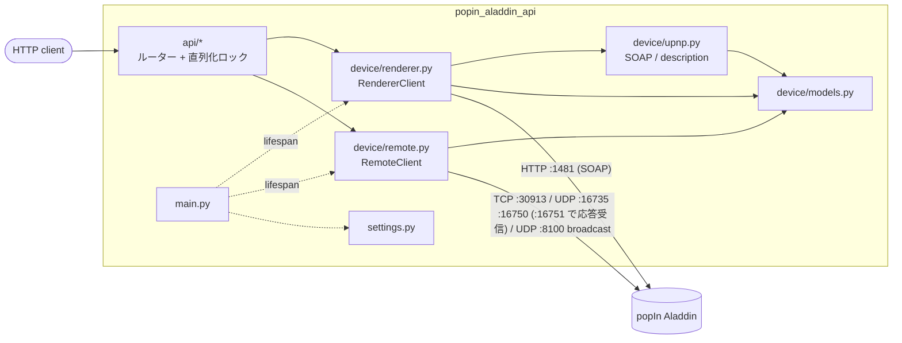

# 開発

セットアップと起動は [README](../README.md) を、lint・test などのタスクは README の「タスク」を参照してください。

## 構成

`src/` レイアウトの単一パッケージです。

```
src/popin_aladdin_api/
  settings.py        環境変数の設定 (pydantic-settings)
  main.py            FastAPI アプリ、lifespan、device 層の例外 → HTTP status
  device/            FastAPI 非依存のデバイス制御層 (async)
    renderer.py      UPnP/DLNA MediaRenderer クライアント (httpx)
    remote.py        独自プロトコル クライアント (asyncio TCP / UDP、発見のブロードキャスト)
    upnp.py          SOAP / device description / DIDL-Lite の純粋関数
    models.py        列挙型 (PlayMode / LightButton / ProjectorKey) と応答モデル
    errors.py        AladdinError / AladdinConnectionError / AladdinSoapError
  api/               FastAPI ルーター
    renderer.py      再生・音量・キャスト・SOAP パススルー
    remote.py        ライト・キー・文字入力・音声・deeplink・デバイス情報・スクリーンショット・電源・発見
    system.py        /health
    schemas.py       リクエストモデル
    deps.py          依存性注入と直列化ロック
tests/               機能ごとの e2e テストと、fake のデバイス・API サーバーの起動 (harness.py)
```



デバイスに触るリクエストはプロセス内の 1 つの `asyncio.Lock` で直列化します。
複数 SOAP 呼び出しから成る操作 (cast, status) の途中に別リクエストが割り込まず、D-pad の押下 → 離上列も崩れません。
同じ理由で uvicorn は単一プロセス (`--workers 1`) で運用します。

各プロトコルの形式は [プロトコルの詳細](protocol.md) にあります。

## テスト

テストは利用者と同じく HTTP で API を呼ぶ e2e テストです。
xdist の worker ごとに、API サーバーを本番と同じ `uvicorn popin_aladdin_api.main:app` で subprocess として起動し、実機の代わりに `tests/harness.py` の fake のデバイスへつなぎます。
fake は [プロトコルの詳細](protocol.md) の UPnP / TCP / UDP の各制御面を localhost の空きポートで受け付け、届いた操作を記録します。
API サーバーには fake の接続先だけを環境変数で渡すので、`mise.toml` の `POPIN_ALADDIN_HOST` (実機) には接続しません。
入力のどんな値でも成り立つべき契約 (文字列がそのままデバイスに届く、範囲外の値を拒否する等) は Hypothesis で入力を生成して確かめます。
`/api/discover` のテストだけは、fake が待ち受ける空きポート宛てに 255.255.255.255 へのブロードキャストを送るので、その UDP のパケットは LAN にも出ます。
coverage は API サーバーの subprocess も計測し、その計測が欠けると `mise run test` は失敗します。

## Docker イメージ

ランナーは shell やパッケージマネージャを持たない distroless (`gcr.io/distroless/cc-debian13:nonroot`) です。
distroless には Python 3.14 のイメージが無いので、ビルダで uv が配布する Python を入れ、実行時に使わないファイル (tcl/tk・pip・ヘッダ等) を除いてからランナーへ写します。
ランナーにはその Python と、依存とこのパッケージを入れた `.venv` だけを置きます。

- UID 65532 の非 root で動きます。root filesystem を read-only にし、capability をすべて外しても動くので、`mise run run-image` はその設定 (`--read-only --cap-drop ALL --security-opt no-new-privileges`) で起動します。
  docker compose では `read_only: true`・`cap_drop: [ALL]`・`security_opt: [no-new-privileges:true]` が同じ設定です。
- shell が無いので、`docker exec <container> sh` では入れず、shell を前提にしたコマンド (compose の healthcheck の `CMD-SHELL`、`command` の中のパイプや変数展開等) も動きません。
  中を調べるときは `docker run --rm --entrypoint python popin-aladdin-api:latest -c '<code>'` で起動します。

## ツールと依存

ツール (uv / prek / dprint / jactionlint / shellcheck / hadolint / typos / zizmor / gitleaks) は `mise.toml` の `[tools]` で exact version に pin し、`mise.lock` でプラットフォームごとの URL / checksum を固定します。
CI (`ci.yaml`) もローカルも同じ `mise.lock` からツールを解決するため、同じ検証をローカルで再現できます。
`[tools]` を手で変更したら `mise lock` を実行して `mise.lock` を追従させ、両方を同じ commit に含めてください (古いままだと CI の `mise install --locked` が失敗します)。

Python 本体は mise ではなく uv が `.python-version` (3.14) に従って取得します。
uv は手元・CI・Docker イメージの build のどれでもこのファイルから Python の minor version を選びます。

Python の依存は、`pyproject.toml` の `[[tool.uv.index]]` で宣言した `https://pypi.flatt.tech/simple/` から取得します。
この宣言は `UV_INDEX_URL` やユーザー設定の `index-url` より優先されます。
ただし `UV_DEFAULT_INDEX` はこの宣言より優先され、`UV_INDEX` やユーザー設定の (`explicit` でない) 追加の index はこの index より先に参照されるので、どれかを設定して `uv lock` を実行すると `uv.lock` の取得元が変わりえます。

`.gitignore` はホワイトリスト方式 (`*` で全て無視し、`!` で許可したものだけを追跡する) です。
新しく追跡したいファイルを追加する場合は、対応する `!` の行を追記してください。

## pre-commit hooks

`mise install` の `postinstall` hook で `prek install` が実行され、`.git/hooks/pre-commit`・`.git/hooks/pre-push`・`.git/hooks/commit-msg` が登録されます。
`.pre-commit-config.yaml` の hook 構成が変わったあとの既存 clone では `mise exec -- prek install` を再実行してください。
以前 pre-commit (Python package。旧 `make precommit-install`) で hook を登録した clone では、`prek install` が旧 hook を `.git/hooks/pre-commit.legacy` として残して呼び続け、`pre-commit` が `.venv` から消えた後は commit が失敗します。
`mise exec -- prek install --force` で置き換えてください (prek 以外の hook を自分で置いている場合は `.git/hooks/*.legacy` の中身を確認してから)。

- Python の hook は、commit・push する変更に Python のファイル (`.py`・`.pyi`)・`pyproject.toml`・`uv.lock`・`.python-version`・`mise.toml`・`mise.lock` が含まれるときに走ります (整形の hook は Python のファイルだけを対象にします)。
  - git commit 時: `ruff-isort` / `ruff-format` hook が commit するファイルの import を並べ替えて整形し、`lint` hook が `mise run lint` を実行します。
  - git push 時: `mise run test` を実行する `test` hook が走ります。
  - ファイルを書き換える hook (整形・README のタスク一覧の同期・空白の修正) は git commit 時だけに走り、git push 時は検査だけを行います。
    push 時の hook は push する commit ではなく作業ツリーに対して走るので、次の作業のファイルを書き換えないためです。
  - `lint` と `test` は作業ツリー全体を検査する手元の事前検査で、push した変更の最終的な判定は PR の CI が行います。
- main を checkout しているときの `git commit` は `no-commit-to-branch` hook が止めます (main への変更は PR 必須で、GitHub の ruleset が強制します)。
  この hook は git commit 時だけに走り、検証用の `mise run pre-commit` では実行しません (main を checkout したままでも検証できるようにするため)。
- [ruff](https://docs.astral.sh/ruff/) (format + lint) と [ty](https://docs.astral.sh/ty/) (型チェック) は strict に設定しています。
  例えば、2 引数目以降は keyword-only にし、相対 import と `from __future__ import annotations` を禁じ、基底のメソッドを上書きするメソッドに `@override` を付けさせます。
  抑制は規則名付きの `# noqa: <code>`・`# ty: ignore[<rule>]` で書きます。`# type: ignore` は無効にしており、規則名の無い `# ty: ignore` もエラーにします。
  ruff / ty / import-linter は `uv run --locked` で `uv.lock` のバージョンを使うので、`uv.lock` が `pyproject.toml` に追従していないと hook (と CI) がここで失敗します。
- [import-linter](https://import-linter.readthedocs.io/): `pyproject.toml` の `[tool.importlinter]` の契約で、`popin_aladdin_api` の中の層の向き (`main` → `api` → `settings` → `device`)、`api`・`device` の中の層の向き、fastapi・httpx・pydantic_settings を直接 import できるモジュールを検査します (`mise run lint` の中で実行)。
  上の層は途中の層を飛ばして下の層を import でき、契約の `layers` で `|` で並べた同じ層のモジュールどうしは import できません。
  `popin_aladdin_api`・`api`・`device` の直下にモジュールを足したら、`exhaustive = true` の契約の `layers` にも足します。
- [dprint](https://dprint.dev/): json / markdown / toml / yaml / Dockerfile のフォーマッタ。
  plugin の WASM URL は `dprint.json` に `url@sha256` の checksum 付きで pin します。`uv.lock` / `mise.lock` は対象外です。
- [jactionlint](https://jactionlint.jdx.dev/) (actionlint の fork): workflow の静的検査。`run:` スクリプトの検査に [shellcheck](https://github.com/koalaman/shellcheck) を使います。
  actionlint と同じ範囲の `correctness` profile で、`warn` の所見も失敗にします。セキュリティの監査は zizmor が行います。
- [hadolint](https://github.com/hadolint/hadolint): Dockerfile の静的検査。
  `.hadolint.yaml` で style を含む全 severity を失敗にし、ベースイメージの registry を docker.io / ghcr.io / gcr.io に限り、OCI label (`org.opencontainers.image.source` / `licenses`) を必須にしています。
  `label-schema` に無い label は拒否するので、label を足すときはそこにも足します。
  Dockerfile 内の `# hadolint ignore=` は無効にしているので、除外が要るときは `.hadolint.yaml` の `ignored` に書きます。
- [typos](https://github.com/crate-ci/typos): 英単語の typo 検査。`typos.toml` で綴りを米国英語に統一しています。
  誤検知は `typos.toml` の `extend-identifiers` (識別子) か `extend-words` (単語) に足して除外します。
- [zizmor](https://docs.zizmor.sh/): workflow と `.pre-commit-config.yaml` のセキュリティ監査。
  `--persona auditor` で false positive を含む全 finding を、`--strict-collection` で解析できない入力を失敗にします。
  GitHub API を使う online audit (impostor-commit 等) は token があるときだけ走るため、CI の `prek` job は hook の代わりに `ZIZMOR_GITHUB_TOKEN` を渡した専用 step で実行します。
  ローカルで同じ範囲を監査するには `ZIZMOR_GITHUB_TOKEN=$(gh auth token) mise exec -- zizmor --persona auditor --strict-collection .` を実行します。
- [gitleaks](https://github.com/gitleaks/gitleaks): シークレットスキャン。pre-commit hook が staged 差分を、CI の `gitleaks` job がコミット履歴全体を対象にします。
- [commitlint](https://commitlint.js.org/): commit message を [Conventional Commits](https://www.conventionalcommits.org/) (`type(scope): subject`) で検査する commit-msg hook。
  ルールは `commitlint.config.mjs`。prek が node と依存を隔離環境へ自前で用意します。

## CI

`.github/workflows/ci.yaml` は pull request 時に以下の job を並列実行します。job の `name` がそのまま required status check の名前になります。

- `prek`: `mise.lock` 通りのツールで、`.pre-commit-config.yaml` の pre-commit stage の hook を全追跡ファイルに対して実行する。
  `lint` hook は `uv run --locked` で動くため、`uv.lock` と `pyproject.toml` の不整合もここで失敗する。
  zizmor は hook の代わりに online audit を含めて token 付きで実行し、gitleaks の hook (staged の差分だけを見る) は `gitleaks` job に任せて実行しない。
- `gitleaks`: コミット履歴全体を対象にシークレットスキャンを行う。
- `verify`: `mise run test` でテストを実行する。
- `image (amd64)` / `image (arm64)`: 各 arch の runner で `mise run check-image` を実行する。

main への push では実行しません (main は PR 必須で、変更は PR の CI で検証してから merge します)。
workflow の外部依存 (`uses:`) は commit SHA で固定し、バージョンをコメントで併記します。

## 依存関係の更新 (Renovate)

`renovate.json` で以下を [Renovate](https://docs.renovatebot.com/) に任せます。Renovate GitHub App をこのリポジトリに対して有効化しておく必要があります。

- `pyproject.toml` の依存と `uv.lock` (範囲内の更新は `lockFileMaintenance` の週次再解決で追従する)。
- `mise.toml` のツールのバージョン bump と、それに伴う `mise.lock` の更新 (同じ PR で行われる)。
- `.pre-commit-config.yaml` の hook `rev` と、`language: node` の hook の `additional_dependencies`。
- workflow の `uses:` の commit SHA と、`dprint.json` の plugin URL / checksum。
- `Dockerfile` のベースイメージ。uv は tag (uv の版) と digest、distroless は `nonroot` tag の digest を更新します。
  - イメージの Python の patch version (と Python に同梱の OpenSSL 等) は uv の版で決まり、新しい Python の配布物を収録した uv の版に上がったときに更新されます (uv の更新がいつも Python を変えるわけではありません)。
  - Renovate の docker datasource が公開日時を取得できるのは Docker Hub だけで、GHCR・GCR のこの 2 つは `minimumReleaseAge` を判定できません。
    そのため、公開日時が無い更新も PR にし (`minimumReleaseAgeBehaviour: timestamp-optional`)、猶予期間の代わりに自動マージせず人手で merge します。
    major 以外の更新 (uv の版と digest) は、他の依存とは別の 1 つの PR にまとめます。

次は Renovate の対象外で、手で書き換えます。

- Python の minor version (`.python-version`)。依存とツールが新しい minor に対応したのを確かめてから上げます (`renovate.json` で pyenv manager を無効にしています)。
- distroless の Debian の世代 (`Dockerfile` の `cc-debian13` のイメージ名)。

更新 PR は毎週月曜 9 時前 (Asia/Tokyo) にまとめて作られます。major 以外の更新は、ベースイメージを除いて 1 つの PR に集約します。
このうち minor / patch は `minimumReleaseAge` (7 日) 経過後、CI green を条件に Renovate 自身が自動マージします (`platformAutomerge: false`)。
major は個別 PR で人手レビューします。

## GitHub リポジトリ設定

ファイルとして管理できないリポジトリ設定です。public リポジトリなので ruleset と secret scanning が使えます。
required checks は `ci.yaml` の job の `name` (`prek` / `gitleaks` / `verify` / `image (amd64)` / `image (arm64)`) に合わせます。

```sh
REPO=msageha/popin-aladdin-api

# merge 方式: squash のみ / squash タイトルは COMMIT_OR_PR_TITLE / merge 後にブランチ自動削除 / wiki off
gh api -X PATCH "repos/$REPO" --input - <<'JSON'
{
  "allow_merge_commit": false,
  "allow_rebase_merge": false,
  "allow_squash_merge": true,
  "squash_merge_commit_title": "COMMIT_OR_PR_TITLE",
  "squash_merge_commit_message": "COMMIT_MESSAGES",
  "delete_branch_on_merge": true,
  "has_wiki": false
}
JSON

# main を PR 必須・CI green 必須・squash merge 限定・force push / 削除禁止・linear history にする
gh api -X POST "repos/$REPO/rulesets" --input - <<'JSON'
{
  "name": "Protect main",
  "target": "branch",
  "enforcement": "active",
  "bypass_actors": [],
  "conditions": {"ref_name": {"include": ["refs/heads/main"], "exclude": []}},
  "rules": [
    {"type": "deletion"},
    {"type": "non_fast_forward"},
    {"type": "required_linear_history"},
    {"type": "pull_request", "parameters": {
      "required_approving_review_count": 0,
      "dismiss_stale_reviews_on_push": false,
      "require_code_owner_review": false,
      "require_last_push_approval": false,
      "required_review_thread_resolution": false,
      "allowed_merge_methods": ["squash"]
    }},
    {"type": "required_status_checks", "parameters": {
      "do_not_enforce_on_create": false,
      "strict_required_status_checks_policy": false,
      "required_status_checks": [
        {"context": "prek", "integration_id": 15368},
        {"context": "gitleaks", "integration_id": 15368},
        {"context": "verify", "integration_id": 15368},
        {"context": "image (amd64)", "integration_id": 15368},
        {"context": "image (arm64)", "integration_id": 15368}
      ]
    }}
  ]
}
JSON

# secret scanning: push protection に加え、non-provider patterns も有効化する
gh api -X PATCH "repos/$REPO" --input - <<'JSON'
{
  "security_and_analysis": {
    "secret_scanning": {"status": "enabled"},
    "secret_scanning_push_protection": {"status": "enabled"},
    "secret_scanning_non_provider_patterns": {"status": "enabled"}
  }
}
JSON

# Actions: GitHub 公式 / verified creator と、workflow が使う action だけを許可し、SHA pin を必須にする
gh api -X PUT "repos/$REPO/actions/permissions" --input - <<'JSON'
{"enabled": true, "allowed_actions": "selected", "sha_pinning_required": true}
JSON
gh api -X PUT "repos/$REPO/actions/permissions/selected-actions" --input - <<'JSON'
{"github_owned_allowed": true, "verified_allowed": true, "patterns_allowed": ["jdx/mise-action@*"]}
JSON

# Dependabot alerts (脆弱性の通知のみ。更新 PR は Renovate が出すので security updates は有効化しない)
gh api -X PUT "repos/$REPO/vulnerability-alerts"
```
