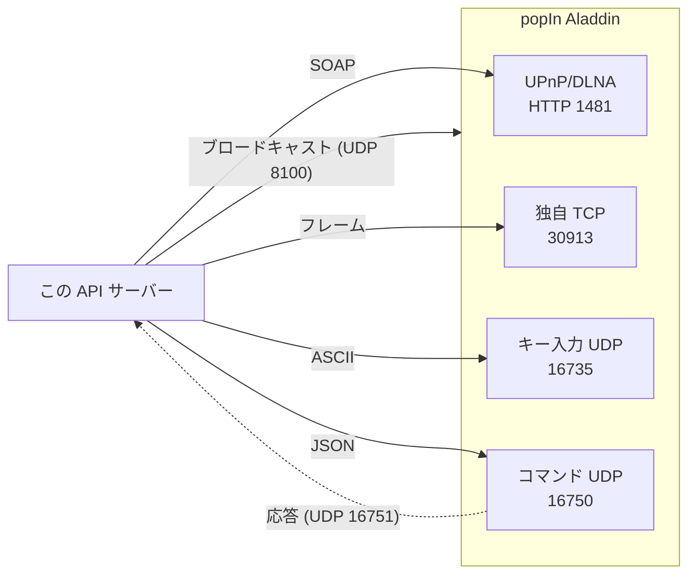
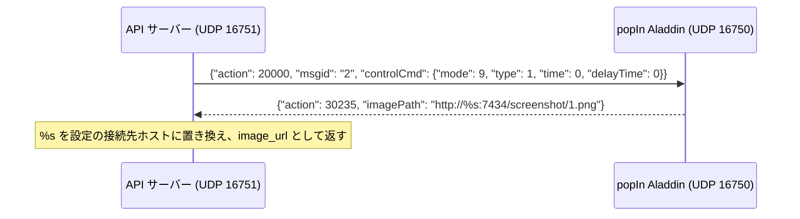

# プロトコルの詳細

popIn Aladdin は、標準の UPnP/DLNA と独自のプロトコルの 2 系統で制御します。
どのチャネルにも認証 (PIN・トークン・ペアリング) はありません。



| ポート    | 系統                    | 用途                                                       | エンドポイント                                                                                                      |
| --------- | ----------------------- | ---------------------------------------------------------- | ------------------------------------------------------------------------------------------------------------------- |
| TCP 1481  | UPnP/DLNA MediaRenderer | 再生状態・音量・キャスト                                   | `/status` `/play` `/volume` `/cast` `/soap` 等                                                                      |
| TCP 30913 | popIn 独自              | ライト・文字入力・音声コマンド・deeplink・情報の照会・ping | `/light` `/keyboard` `/voice` `/deeplink` `/remote/version` `/remote/album` `/remote/apps/{package}` `/remote/ping` |
| UDP 16735 | XGIMI GMSDK             | リモコンのキー入力                                         | `/key`                                                                                                              |
| UDP 16750 | XGIMI GMSDK             | スクリーンショット・メモリ解放・実行時情報・電源断         | `/capture` `/memory/free` `/remote/device` `/power/off`                                                             |
| UDP 8100  | 発見                    | LAN 内のデバイスの発見                                     | `/discover`                                                                                                         |

エンドポイントは `/api` を省いて書きます。ポートは設定で変えられます (README「設定」)。
独自プロトコルは、公式スマートフォンアプリ Aladdin X (`cc.popin.aladdin.assistant` 3.6.25) の静的解析で復元したものです。

## 動作の確認状況

| 状況                                                                                                      | 対象                                                                                                                                                                                                                                           |
| --------------------------------------------------------------------------------------------------------- | ---------------------------------------------------------------------------------------------------------------------------------------------------------------------------------------------------------------------------------------------- |
| 実機で確認済み ([kmaehashi/popin-aladdin-light](https://github.com/kmaehashi/popin-aladdin-light) の実測) | ライト、方向キー、`back` `menu` `vol_up` `vol_down` `power`、文字入力、音声コマンド、ping                                                                                                                                                      |
| 静的解析だけで、実機 (popIn Aladdin 2) では未確認                                                         | `/remote/version` `/remote/album` `/remote/apps/{package}` `/remote/device` `/discover` `/deeplink` `/memory/free` `/capture` `/power/off`、`/key` の `focus_*` `home_long` `menu_long` `settings` `netflix` `youtube` `prime_video` `custom*` |

## UPnP/DLNA MediaRenderer (TCP 1481)

```
GET  http://<host>:1481/                              … device description
POST http://<host>:1481/<Service>/<UDN>/control.xml   … SOAP
```

device description から各サービスの `controlURL` を解決し、SOAP でアクションを呼びます。
UDN と controlURL は MAC アドレスから決まり機体ごとに変わらないので、device description はプロセスが動いている間キャッシュします。
実機の friendly name は `Aladdin 2` です。

| サービス              | 主なアクション                                                                                                                     |
| --------------------- | ---------------------------------------------------------------------------------------------------------------------------------- |
| **AVTransport**       | GetTransportInfo / GetPositionInfo / GetMediaInfo / Play / Pause / Stop / Next / Previous / Seek / SetAVTransportURI / SetPlayMode |
| **RenderingControl**  | GetVolume / SetVolume (0..100) / GetMute / SetMute                                                                                 |
| **ConnectionManager** | GetProtocolInfo                                                                                                                    |

## 独自プロトコル

公式アプリが使う、popIn 独自の TCP と、XGIMI 製プロジェクター用の制御 SDK (GMSDK、`com.xgimi.gmsdk`) の UDP です。

### TCP 30913

1 フレームは、6 バイトのヘッダ `struct '<IBB'` と JSON の payload から成ります。1 接続で複数のフレームを送れます。

| バイト | 型     | 内容                                |
| ------ | ------ | ----------------------------------- |
| 0..3   | uint32 | payload の長さ (little-endian)      |
| 4      | uint8  | フレーム種別                        |
| 5      | uint8  | JSON 種別 (フレーム種別 `1` のとき) |
| 6..    | JSON   | payload                             |

| フレーム種別 | 内容                                       | 送る payload                                              | 返る payload の key                                                                                                                                                     |
| ------------ | ------------------------------------------ | --------------------------------------------------------- | ----------------------------------------------------------------------------------------------------------------------------------------------------------------------- |
| `0`          | heartbeat (`/remote/ping`)                 | 無し、または `1`                                          | フレーム種別 `0`・JSON 種別 `0` の、payload の無いフレーム                                                                                                              |
| `3`          | Version ハンドシェイク (`/remote/version`) | `{"code": 10, "type": "JSON", "deviceId": "<uuid>", ...}` | `{"model", "device_name", "pid", "platform", "osVersion", "sdkInt", "totalSpace", "freeSpace", "lang", "country", "featureAccess", "capability", ...}` (同じ種別で返る) |
| `1`          | 操作                                       | JSON 種別ごとに下の表                                     | 下の表                                                                                                                                                                  |

フレーム種別 `1` の JSON 種別:

| JSON 種別 | 名前          | 用途                                     | 送る payload                         | 返る payload の key (同じ種別)                                                             | エンドポイント           |
| --------- | ------------- | ---------------------------------------- | ------------------------------------ | ------------------------------------------------------------------------------------------ | ------------------------ |
| `7`       | RemoteControl | ライトの操作                             | `{"action": <code>}`                 | (待たない)                                                                                 | `/light`                 |
| `9`       | VoiceCommand  | 音声コマンドのテキストを注入する         | `{"text": "...", "success": true}`   | (待たない)                                                                                 | `/voice`                 |
| `10`      | IMECommand    | フォーカス中の入力欄へ文字を入力する     | `{"text": "..."}`                    | (待たない)                                                                                 | `/keyboard`              |
| `15`      | DeeplinkInfo  | URL scheme・intent を開く (アプリの起動) | `{"deepLink": "..."}`                | (待たない)                                                                                 | `/deeplink`              |
| `16`      | QueryAppInfo  | アプリのインストールの有無と版を照会する | `{"pkgName": "...", ...}`            | `{"isInstalled", "versionCode", "versionName"}`                                            | `/remote/apps/{package}` |
| `2`       | Album         | フォトメモリーの枚数と容量を照会する     | `{"actionCode": 0, "count": 0, ...}` | `{"count", "list": [{"name", "size", "type"}], "freeSpace", "totalSpace", "lightVersion"}` | `/remote/album`          |

「(待たない)」は、この API が応答を待たないものです。
Version の応答の `featureAccess` は機能名ごとの利用可否 (`1` = 利用可)、`capability` は機能名ごとの対応 (`1` = 対応、`null` = 不明) を持つ object です。

ライトの action code (JSON 種別 `7`):

| ボタン | switch | brighter | darker | cooler | warmer | full | night | on | off | eco | sleep |
| ------ | ------ | -------- | ------ | ------ | ------ | ---- | ----- | -- | --- | --- | ----- |
| code   | 31     | 32       | 33     | 34     | 35     | 36   | 37    | 38 | 39  | 40  | 41    |

アプリの定数表には、ほかにキー操作の code (1 shutdown, 2 screenshot, 3/4 volume, 5..18 キー, 19 clear memory, 22/23 focus, 42 settings, 51..55 ショートカット, 1001 child protect) もあります。
Aladdin 2 ではアプリがこれらを UDP で送るので、この API も UDP を使います。

アプリはほかの JSON 種別も使いますが、この API では実装していません: `1` FileHead / `8` FileSendInfos (写真の転送。本体はフレーム種別 `2` で送る)、`3` RequestAlbumFile、`4` PlayImg / `5` StopImg / `6` DelImg (フォトメモリーの表示・削除)、`11`..`14` 誕生日 (holiday) の設定、`17` Karaoke、`19`..`21` Aladdin Poca の間接照明、`120` Response。

#### ハンドシェイクと認証

アプリは接続のたびに Version ハンドシェイク (クライアントの UUID を送る) をします。
ライト・文字入力・音声コマンド・ping はハンドシェイク無しで効きます (kmaehashi の実測)。照会のコマンドで要るかは確かめていないので、この API は照会だけアプリと同じ順 (Version → 照会) で送ります。

SDK の `GMCheckAuthentication` (MD5 によるアプリ鍵の検査) と、XGIMI 系機種向けの TCP 13145 の認証コード (`AuthCode`) は、アプリ内で使われていません。

### キー入力 (UDP 16735)

ASCII のデータグラムを送ります。この API は応答を待ちません。

| 操作           | 送る列                                                                                  | キー (code)                                                                                                                                                                |
| -------------- | --------------------------------------------------------------------------------------- | -------------------------------------------------------------------------------------------------------------------------------------------------------------------------- |
| 方向キー       | `KEYSSTATUS:<code>+1` → 0.1 秒 → 全方向キーの `KEYSSTATUS:<code>+0` → 押したキーの `+0` | home 35, up 36, right 37, down 38, ok 49, left 50                                                                                                                          |
| フォーカス調整 | `KEYSSTATUS:<code>+1` → `KEYSSTATUS:<code>+0`                                           | focus_plus 253, focus_minus 254                                                                                                                                            |
| HOME 長押し    | `KEYSSTATUS:35+1` を 30 回 → 1 秒 → `KEYSSTATUS:35+0`                                   | home_long                                                                                                                                                                  |
| 単発キー       | `KEYPRESSES:<code>`                                                                     | back 48, vol_down 114, vol_up 115, power (電源メニュー) 116, menu 139, menu_long 251, settings 300, netflix 301, youtube 302, prime_video 303, custom 304, custom_long 305 |

方向キーの離上の列は kmaehashi の実測に合わせています。
SDK には 3D (252)・ゲームパッド (154..170, 244) の定数もありますが、Aladdin では使われていません。
同じポートにはエアマウス (`TOUCHEVENT:<dx>+<dy>`) も送れますが、この API では実装していません。

### コマンド (UDP 16750)

次の JSON を送ります。

```
{"action": 20000, "msgid": "2", "controlCmd": {"mode": <mode>, "type": <type>, "time": 0, "delayTime": 0}}
```

応答は、送信元のポートではなくクライアントの UDP 16751 に JSON で届きます。
そのため、この API サーバーはアプリと同じく 16751 に bind して送受信し、Docker ではこのポートを UDP で公開します。



| mode / type | 内容                              | 応答の key                                                                                 | エンドポイント   |
| ----------- | --------------------------------- | ------------------------------------------------------------------------------------------ | ---------------- |
| `9` / `1`   | スクリーンショット                | `{"action": 30235, "imagePath": "http://%s..."}` (`%s` はデバイスの IP)                    | `/capture`       |
| `9` / `2`   | メモリ解放                        | (待たない)                                                                                 | `/memory/free`   |
| `32` / `0`  | 実行時情報                        | `{"action": 30410, "deviceName", "deviceMode", "deviceApp", "packageApp", "runtime", ...}` | `/remote/device` |
| `6` / `0`   | 電源断 (アプリの電源ボタン長押し) | (待たない)                                                                                 | `/power/off`     |

この API で実装していないもの: type 3 + `time` (オフタイマー)、mode 3 / 4 (3D・画質モード)、mode 2 + `zoomfocus` (フォーカス値の指定)、mode 5 + `data` (音声コマンド)、mode 7 / type 3 (アプリ一覧)、action 30200 + `customPlay` (URL の再生)。

SDK には action 10000 (接続)・10002 (heartbeat)・9998 (UDP 16752 へのブロードキャスト検索) もありますが、コマンドの前に送る必要はありません ([Home Assistant の XGIMI 実装](https://github.com/manymuch/Xgimi-4-Home-Assistant) も接続せずに送ります)。

### 発見 (UDP 8100)

`"aladdin"` + `0x14` を 1024 バイトに 0 で詰めてブロードキャストすると、各デバイスが次の形で応答します。

| 部分      | 長さ                                                      | 内容                                                                                                           |
| --------- | --------------------------------------------------------- | -------------------------------------------------------------------------------------------------------------- |
| `aladdin` | 7 バイト                                                  | 固定                                                                                                           |
| 種別      | 1 バイト                                                  | 17 / 19 / 21                                                                                                   |
| 長さ      | 種別 17 なら 1 バイト、19 / 21 なら 4 バイト (big-endian) | JSON の長さ                                                                                                    |
| JSON      | 可変                                                      | `{"success": true, "data": {"ipAddress", "model", "name", "pid", "mac", "version", "zipcode", "isConnected"}}` |

## 対象外のポート

デバイスはほかに AirPlay (7000 / 7100) と AndServer (7434) を公開していますが、アプリのコードに 7434 へのアクセスは無く、この API の対象外です。
XGIMI 系機種 (Aladdin Marca 等) 向けの TCP 13145 (壁面補正) と UDP 16737 (タッチマウス) も対象外です。
